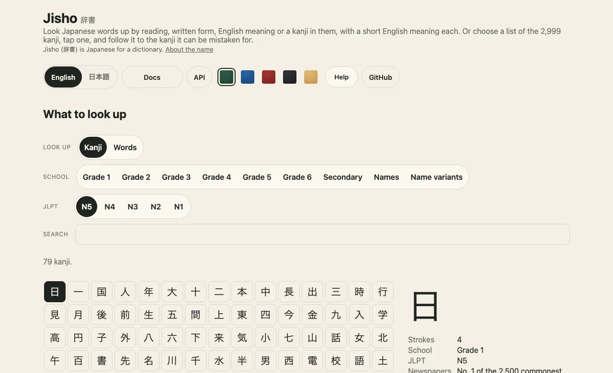
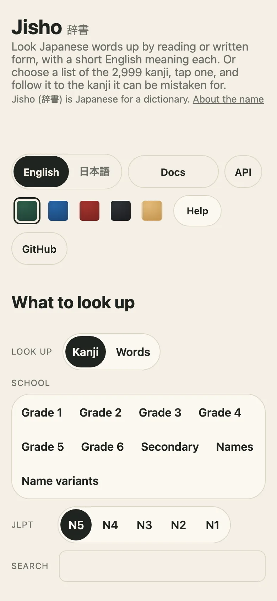
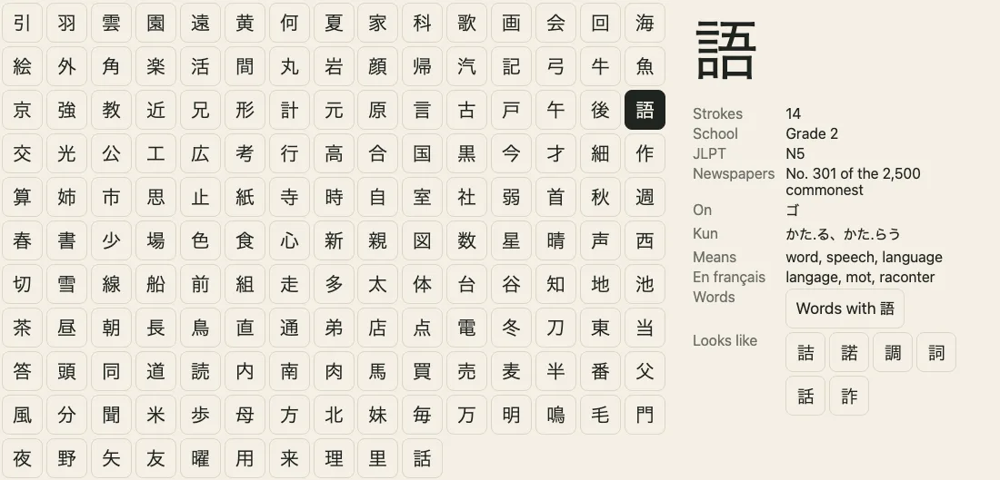
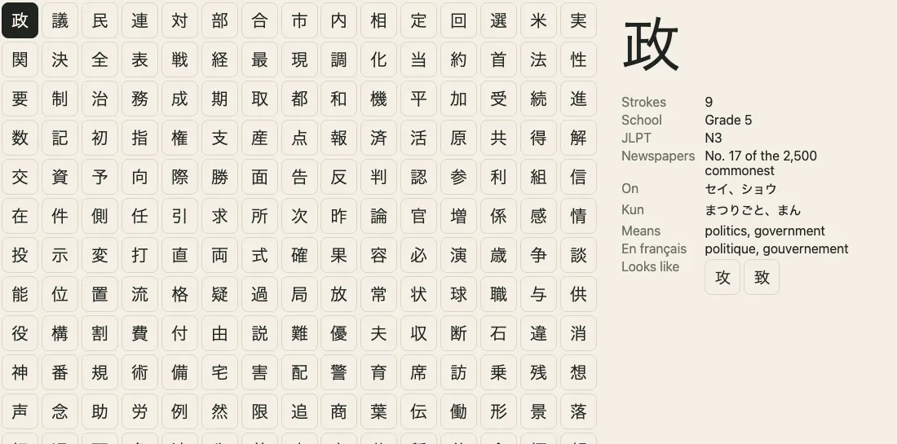
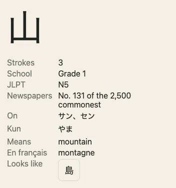
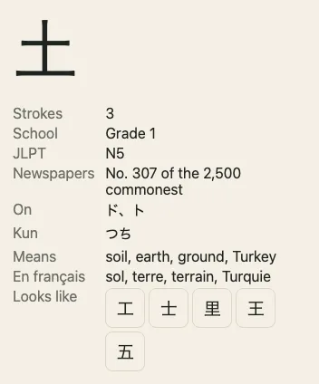
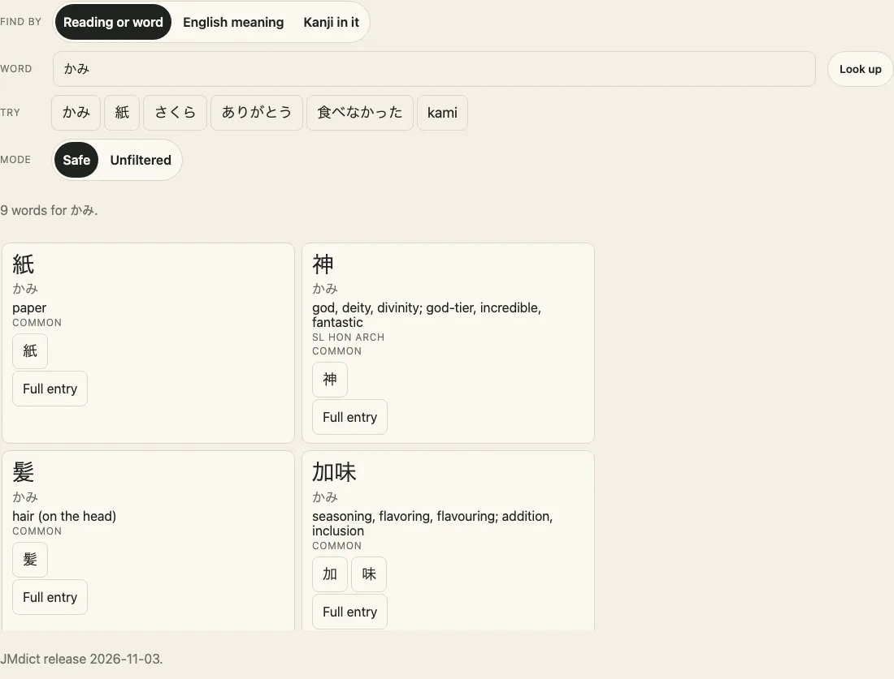
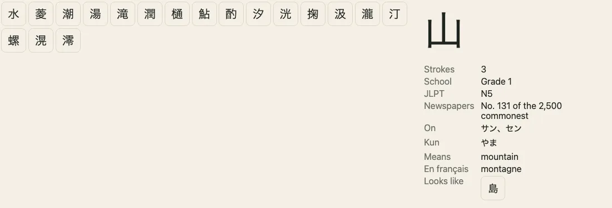
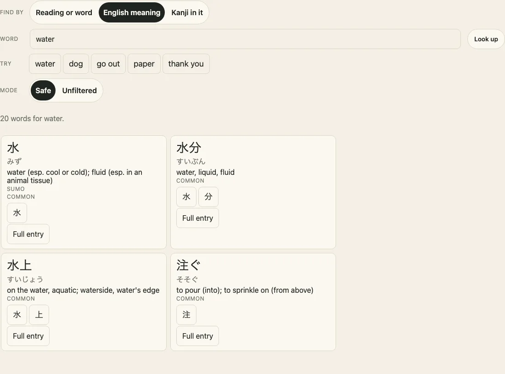
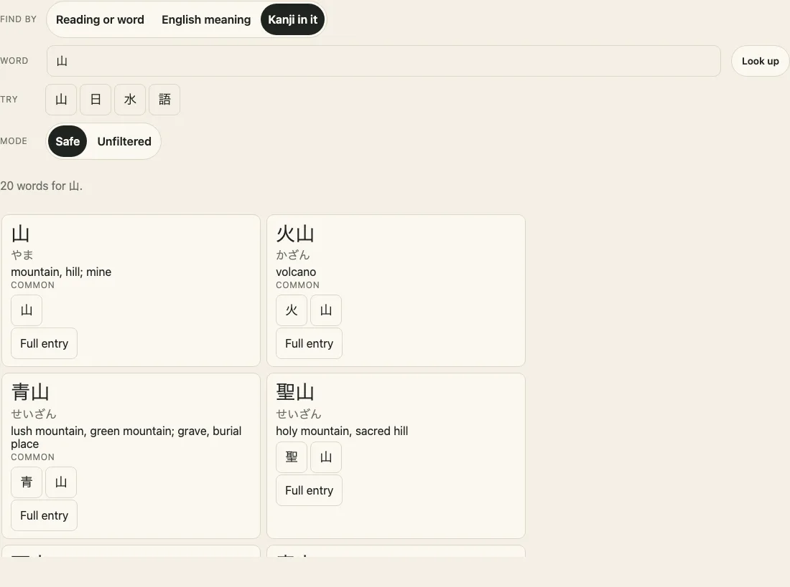

<h1 align="center">Jisho <sub>辞書</sub> — Japanese word and kanji data for JavaScript</h1>

<p align="center"><strong>Jisho 辞書: Japanese word and kanji data for JavaScript: look words up by reading, written form, English meaning, a kanji in them or romaji, and read the school grades, JLPT levels, readings, meanings and look-alike pairs of 2,999 kanji.</strong><br>
The words are JMdict's, in small pieces that a lookup fetches as it needs them, with every sense carrying the marks JMdict gives it, and a safe mode, the default, that leaves out what is vulgar, X-rated, sensitive or derogatory and never fetches the files that hold it. Every table is machine output from public sources, each named with its licence: JMdict and KANJIDIC2, Jonathan Waller's JLPT lists and Lars Yencken's kanji confusion datasets. Typed, with no dependencies, and a demo to try it in.</p>

<p align="center" lang="ja">JavaScript向けの、日本語の単語と漢字のデータセットです。JMdictの単語を読み、表記、英語の意味、含まれる漢字、ローマ字から引け、必要な小さなチャンクだけを取得します。初期値のセーフモードは、下品、性的、配慮が必要、侮辱的とJMdictが記す語義を除き、それを含むファイルを取得しません。各語義にはJMdictの印が付き、「フィルターなし」も選べます。2,999字の漢字の学年、JLPTレベル、読み、意味、形の似た漢字の組も収め、型付きで外部依存はありません。</p>

<p align="center">
  <a href="https://github.com/johnmorrisdotca/jisho/actions/workflows/ci.yml"></a>
  <a href="https://www.npmjs.com/package/@johnmorrisdotca/jisho"></a>
  <a href="./LICENSE"></a>
  <a href="./NOTICE.md"></a>
  
  
  <a href="https://johnmorrisdotca.github.io/jisho/docs/api/main/index.html"></a>
  <a href="https://www.npmjs.com/package/@johnmorrisdotca/jisho#provenance"></a>
</p>

<p align="center"><a href="https://johnmorrisdotca.github.io/jisho/"><strong>Try the demo →</strong></a> · <a href="https://johnmorrisdotca.github.io/jisho/docs/">Documentation</a> · <a href="https://johnmorrisdotca.github.io/jisho/docs/guides/getting-started.html">Getting started</a> · <a href="https://johnmorrisdotca.github.io/jisho/api.html">API reference</a></p>

<table align="center">
<tr>
<td align="center" valign="top">
<picture>
<source media="(prefers-color-scheme: dark)" srcset="https://raw.githubusercontent.com/johnmorrisdotca/jisho/main/docs/images/hero-desk-dark.webp">

</picture><br>
<em>On a desk: JLPT N5, with 日 open beside its list.</em>
</td>
<td align="center" valign="top">
<picture>
<source media="(prefers-color-scheme: dark)" srcset="https://raw.githubusercontent.com/johnmorrisdotca/jisho/main/docs/images/hero-phone-dark.webp">

</picture><br>
<em>On a phone.</em>
</td>
</tr>
</table>
<p align="center">Look a word up, or choose a list, tap a kanji, and follow it to the kanji it can be mistaken for.</p>

## In 30 seconds

```sh
npm install @johnmorrisdotca/jisho
```

```ts
import { gradeOf, levelOf, lookAlikes } from "@johnmorrisdotca/jisho";
import { GRADES } from "@johnmorrisdotca/jisho/grades";
import { JLPT } from "@johnmorrisdotca/jisho/jlpt";
import { LOOK_ALIKE } from "@johnmorrisdotca/jisho/look-alike";
import { loadWords, wordsOf } from "@johnmorrisdotca/jisho/words";

const words = await loadWords("かみ"); // fetches one small piece of the dictionary
console.log(wordsOf(words, "かみ").slice(0, 3).map((one) => `${one.written} ${one.meaning}`)); // 紙 paper, 神 god…
console.log(gradeOf(GRADES, "語")); // 2
console.log(levelOf(JLPT, "語")); // N5
console.log(lookAlikes(LOOK_ALIKE, "土")[0]?.kanji); // the closest look-alike of 土
```

## Who it is for

- **Games and quizzes** that take any kana as a guess and want to show what it means, with the safe mode's answer by default, and that fetch a few kilobytes to do it.
- **Language learning apps** that look words up by reading or written form, and order kanji by school year or JLPT level, and want to warn a learner about the pair they are about to confuse.
- **Text tools** that say how hard a piece of Japanese is, from the kanji in it.
- **Quizzes** that need a list of kanji with their readings and meanings, and wrong answers that look right.
- **Anybody who needs the data under terms they can read**: every table names its source and its licence, and no row comes from a commercial study service.

## Features

- **[Words](#the-words)**: JMdict's rows, found by reading or written form, commonest first, each with a short English meaning and how common it is, in 294 pieces by reading and 71 of an index of written forms, so a lookup fetches about 25 kB gzipped.
- **[Find by meaning, by kanji, or in romaji](#find-words-by-what-they-mean-or-by-a-kanji)**: `findByMeaning("water")`, `wordsWithKanji("山")` and `loadWords("kami", { romaji: true })`, each with an index in small pieces of its own that a plain lookup never fetches.
- **Odd input is nothing, never a crash**: full-width and half-width, stray spaces, invisible characters and far too much text are made plain or answered with no words, and a piece that cannot be fetched is asked for once more and then rejects with a `WordsLoadError` that names it.
- **Safe by default, unfiltered when asked**: `mode: "safe"` leaves out a sense JMdict marks vulgar, X-rated, sensitive or derogatory, and a word with nothing else to say, and fetches only files that hold none of it. `mode: "unfiltered"` is everything JMdict has. Every sense carries its marks, and the consumer's own `block` and `allow` lists, and a few small tools, do the rest. Jisho keeps no list of words of its own.
- **[School grades](#the-school-grades)**: 2,999 kanji by grade, 1,026 of them taught in elementary school and 2,136 in all for everyday use.
- **[JLPT levels](#the-jlpt-levels)**: 2,211 kanji on Jonathan Waller's five lists, N5 to N1.
- **[A table of the kanji](#the-table)**: strokes, grade, level, newspaper rank, on and kun readings, and meanings in English and French.
- **[Look-alike pairs](#the-look-alike-pairs)**: 7,211 pairs with two published scores each, by strokes and by parts.
- **Plain functions**: which grade, which level, the kanji in a text, a search by reading or meaning.
- **Each table an entry point**: importing the grades loads 8 KB gzipped, not the table of 146 KB. The 26,039 common words that safe mode keeps are one table of their own.

### What's in it

<table>
<tr>
<td align="center" valign="top">
<picture>
<source media="(prefers-color-scheme: dark)" srcset="https://raw.githubusercontent.com/johnmorrisdotca/jisho/main/docs/images/school-grade-desk-dark.webp">

</picture><br>
<sub>A school year: grade 2's 160 kanji.</sub>
</td>
<td align="center" valign="top">
<picture>
<source media="(prefers-color-scheme: dark)" srcset="https://raw.githubusercontent.com/johnmorrisdotca/jisho/main/docs/images/jlpt-level-desk-dark.webp">

</picture><br>
<sub>A JLPT level: N3, in the order of the list.</sub>
</td>
</tr>
<tr>
<td align="center" valign="top">
<picture>
<source media="(prefers-color-scheme: dark)" srcset="https://raw.githubusercontent.com/johnmorrisdotca/jisho/main/docs/images/kanji-card-desk-dark.webp">

</picture><br>
<sub>One kanji in full, from the table.</sub>
</td>
<td align="center" valign="top">
<picture>
<source media="(prefers-color-scheme: dark)" srcset="https://raw.githubusercontent.com/johnmorrisdotca/jisho/main/docs/images/look-alike-desk-dark.webp">

</picture><br>
<sub>What 土 can be mistaken for.</sub>
</td>
</tr>
<tr>
<td align="center" valign="top">
<picture>
<source media="(prefers-color-scheme: dark)" srcset="https://raw.githubusercontent.com/johnmorrisdotca/jisho/main/docs/images/words-desk-dark.webp">

</picture><br>
<sub>A word by its reading: かみ is paper, god and hair.</sub>
</td>
<td align="center" valign="top">
<picture>
<source media="(prefers-color-scheme: dark)" srcset="https://raw.githubusercontent.com/johnmorrisdotca/jisho/main/docs/images/search-desk-dark.webp">

</picture><br>
<sub>A search by meaning, the commonest first.</sub>
</td>
</tr>
<tr>
<td align="center" valign="top">
<picture>
<source media="(prefers-color-scheme: dark)" srcset="https://raw.githubusercontent.com/johnmorrisdotca/jisho/main/docs/images/words-meaning-desk-dark.webp">

</picture><br>
<sub>Words by their English meaning: water.</sub>
</td>
<td align="center" valign="top">
<picture>
<source media="(prefers-color-scheme: dark)" srcset="https://raw.githubusercontent.com/johnmorrisdotca/jisho/main/docs/images/words-kanji-desk-dark.webp">

</picture><br>
<sub>Words written with 山, each leading to its kanji.</sub>
</td>
</tr>
</table>

## Use it in your project

### Install

```sh
npm install @johnmorrisdotca/jisho
pnpm add @johnmorrisdotca/jisho
yarn add @johnmorrisdotca/jisho
```

For a page with no bundler:

```html
<script type="module">
  import { gradeOf } from "https://cdn.jsdelivr.net/npm/@johnmorrisdotca/jisho@2/+esm";
  import { GRADES } from "https://cdn.jsdelivr.net/npm/@johnmorrisdotca/jisho@2/grades/+esm";
  console.log(gradeOf(GRADES, "語"));
</script>
```

### Install under another name

Jisho is the Japanese name; the English job is Japanese word and kanji data. npm can install a package under a name of your own:

```sh
npm install japanese-data@npm:@johnmorrisdotca/jisho
```

```ts no-check
import { gradeOf } from "japanese-data";
```

### On a server or in a script

Import the tables you read. Nothing here needs a browser or a network.

```ts
import { kanjiOfGrade } from "@johnmorrisdotca/jisho";
import { GRADES } from "@johnmorrisdotca/jisho/grades";

console.log(kanjiOfGrade(GRADES, 1).slice(0, 5));
```

### Words, a few kilobytes at a time

`loadWords` fetches the pieces of the dictionary that the texts you give it are in, and `wordsOf` then reads them with no waiting. Fetch them when a page needs them, not when it opens:

```ts
const { loadWords, wordsOf } = await import("@johnmorrisdotca/jisho/words");
const words = await loadWords(["かみ", "紙"]);
console.log(wordsOf(words, "紙")[0]?.meaning); // paper
```

```ts no-check
// In a server, import it only where a lookup is made, and mark the package external:
// next.config.ts: serverExternalPackages: ["@johnmorrisdotca/jisho"]
const { loadWords } = await import("@johnmorrisdotca/jisho/words");
```

A bundler that follows `loadWords` reaches every piece, about 48 MB, so a server that imports `words` at the top of a page carries all of it. [Look words up](https://johnmorrisdotca.github.io/jisho/docs/guides/words.html) says how to keep it out of a server's bundle, and how to look many common words up in one table.

### In a page, when it is wanted

The table of the kanji is the largest of the kanji, at 146 KB gzipped, so a page can fetch it when it is first needed:

```ts
import { readKanji } from "@johnmorrisdotca/jisho";

const { KANJI } = await import("@johnmorrisdotca/jisho/kanji");
console.log(readKanji(KANJI).length); // 2999
```

## Examples

### What a guess means

A word game that takes any kana as a guess can say what it means. A reading shared by several words gives them commonest first, each with its written form.

```ts
import { loadWords, wordsOf } from "@johnmorrisdotca/jisho/words";

const words = await loadWords("かみ");
for (const one of wordsOf(words, "かみ").slice(0, 3)) console.log(one.written, one.reading, one.meaning);
```

### A word by its written form

A text with anything but kana in it is looked up as a written form, and hiragana and katakana find the same words.

```ts
import { loadWords, wordsOf } from "@johnmorrisdotca/jisho/words";

const words = await loadWords(["神", "カミ"]);
console.log(wordsOf(words, "神").map((one) => one.reading).slice(0, 3)); // かみ, しん, じん…
console.log(wordsOf(words, "カミ")[0]?.written); // 紙
```

### Safe by default, unfiltered when asked

A lookup is in safe mode unless it says `mode: "unfiltered"`. Safe leaves out a sense JMdict marks vulgar (`vulg`), X-rated (`X`), sensitive (`sens`) or derogatory (`derog`), the written forms and readings only such a sense gives, and a word with nothing else to say, and it fetches only files that hold none of it. Unfiltered is everything JMdict has. Each sense says what JMdict marks it, so a consumer can leave out more.

```ts
import { loadWords, meaningOf } from "@johnmorrisdotca/jisho/words";

const words = await loadWords("ほもびでお");
console.log(meaningOf(words, "ほもびでお")); // null: safe mode has no word to say

const everything = await loadWords("ほもびでお", { mode: "unfiltered" });
console.log(meaningOf(everything, "ほもびでお")); // gay porn video, gay pornographic video
```

### Your own lists

A consumer decides what else to leave out. `block` names readings and written forms to leave out and `allow` the only ones to keep, in either kana, on top of the mode. Each is applied only when passed.

```ts
import { loadWords, wordsOf } from "@johnmorrisdotca/jisho/words";

const words = await loadWords("かみ", { block: ["神"] });
console.log(wordsOf(words, "かみ").map((one) => one.written).slice(0, 3)); // ["紙", "髪", "加味"]
```

### Find words by what they mean, or by a kanji

`findByMeaning` finds the commonest words whose English meaning holds the whole word you give it, and `wordsWithKanji` the commonest written with a kanji. Each has an index of its own, in pieces of about 15 kB gzipped, fetched only when it is asked, and then reads the dictionary pieces of the words it found (at most `limit`, 10 unless you say, and never more than 20). They take the same `mode`, `block` and `allow` as `loadWords`. `kanjiOfWord` links a word to the entries of the kanji table for the kanji in it.

```ts
import { readKanji } from "@johnmorrisdotca/jisho";
import { KANJI } from "@johnmorrisdotca/jisho/kanji";
import { findByMeaning, kanjiOfWord, wordsWithKanji } from "@johnmorrisdotca/jisho/words";

const table = readKanji(KANJI);
console.log((await findByMeaning("water", { limit: 3 })).map((one) => `${one.written} ${one.meaning}`));
for (const word of await wordsWithKanji("山", { limit: 3 }))
  console.log(word.written, word.meaning, kanjiOfWord(word, table).map((one) => `${one.kanji} grade ${one.grade}`));
```

### Romaji

Ask `loadWords` and `wordsOf` for `romaji: true` and a text of Latin letters is read as modified Hepburn (or Kunrei): `kami` is かみ, `gakkō` is がっこう. A macron is a long vowel, which a reading writes more than one way, so every way is looked up (`kōhī` finds コーヒー). It is off unless asked, because `CD` and `AI` are written forms too. `romajiToKana` is the conversion alone.

```ts
import { loadWords, romajiToKana, wordsOf } from "@johnmorrisdotca/jisho/words";

const words = await loadWords(["kami", "Tōkyō"], { romaji: true });
console.log(wordsOf(words, "kami", { romaji: true })[0]?.written); // 紙
console.log(wordsOf(words, "Tōkyō", { romaji: true })[0]?.written); // 東京
console.log(romajiToKana("gakkō")); // がっこう
```

### How common a word is

Each word carries JMdict's priority tags (`news1`, `ichi1`, `spec2`, `gai1`, `nf05`…) and one `rank` made from them, lower being commoner and 100,000 for a word JMdict does not rank. A lookup already gives the commonest first; `commonestFirst` puts any list in that order.

```ts
import { loadWords, wordsOf } from "@johnmorrisdotca/jisho/words";

const words = await loadWords("かみ");
console.log(wordsOf(words, "かみ").slice(0, 3).map((one) => [one.written, one.rank, one.priority.join(" ")]));
```

### A word as a sentence writes it

Jisho looks up what the dictionary lists and does no conjugation of its own. For 食べました, take the proposals of [Hikidashi](https://github.com/johnmorrisdotca/hikidashi)'s `dictionaryForms` and keep the ones the dictionary says are that kind of word:

```ts
import { dictionaryForms } from "@johnmorrisdotca/hikidashi/deinflect";
import { loadWords, wordsOf } from "@johnmorrisdotca/jisho/words";

const LETTER = { godan: "g", ichidan: "i", iAdjective: "a", suru: "s", kuru: "k" } as const;

async function dictionaryWords(written: string) {
  const proposals = dictionaryForms(written);
  const words = await loadWords([written, ...proposals.map((one) => one.base)]);
  return [
    ...wordsOf(words, written),
    ...proposals.flatMap((one) => wordsOf(words, one.base).filter((word) => word.kinds.includes(LETTER[one.wordClass]))),
  ];
}

console.log((await dictionaryWords("食べました"))[0]?.written); // 食べる
console.log((await dictionaryWords("高くて"))[0]?.written); // 高い
```

### Leave out by mark

Every sense carries the marks JMdict gives it: usage (`col`, `sl`, `arch`, `obs`, `uk`…), a field (`food`, `med`…) and a dialect (`ksb`…). A few small pure tools work on what a lookup returned, and apply nothing unless you call them: `hasMarks`, `withoutMarks`, `withoutWords` and `onlyWords`. `SAFE_MARKS` is the list safe mode leaves out, for reference.

```ts
import { loadWords, withoutMarks, wordsOf } from "@johnmorrisdotca/jisho/words";

const words = await loadWords("かみ", { mode: "unfiltered" });
const modern = withoutMarks(wordsOf(words, "かみ"), ["arch", "obs"]);
console.log(modern.length < wordsOf(words, "かみ").length); // true
```

### Add to what is loaded

```ts
import { loadWords, wordsOf } from "@johnmorrisdotca/jisho/words";

const first = await loadWords("かみ");
const second = await loadWords("いぬ", { previous: first });
console.log(wordsOf(second, "いぬ")[0]?.written); // 犬
```

### Many common words at once

The common words are one table of about 820 kB gzipped, for a page that looks up many and needs none of the rare ones.

```ts
import { loadCommonWords, meaningOf } from "@johnmorrisdotca/jisho/words";

const words = await loadCommonWords();
console.log(meaningOf(words, "山")); // mountain
```

### Every elementary-school kanji

`ELEMENTARY_GRADES` is grades 1 to 6, and `JOYO_GRADES` adds the rest of the everyday kanji.

```ts
import { ELEMENTARY_GRADES, JOYO_GRADES, kanjiOfGrade } from "@johnmorrisdotca/jisho";
import { GRADES } from "@johnmorrisdotca/jisho/grades";

console.log(ELEMENTARY_GRADES.flatMap((grade) => kanjiOfGrade(GRADES, grade)).length); // 1026
console.log(JOYO_GRADES.flatMap((grade) => kanjiOfGrade(GRADES, grade)).length); // 2136
```

### One JLPT level

A level does not count the levels below it, and is in the order of Waller's list.

```ts
import { kanjiOfLevel } from "@johnmorrisdotca/jisho";
import { JLPT } from "@johnmorrisdotca/jisho/jlpt";

console.log(kanjiOfLevel(JLPT, "N5").slice(0, 3)); // ["日", "一", "国"]
```

### The levels in a piece of text

`kanjiIn` takes the kanji out of a text, once each.

```ts
import { kanjiIn, levelOf } from "@johnmorrisdotca/jisho";
import { JLPT } from "@johnmorrisdotca/jisho/jlpt";

console.log(kanjiIn("日本語を勉強します").map((one) => [one, levelOf(JLPT, one)]));
```

### Look a kanji up

Build a `Map` once if a page looks up more than a few.

```ts
import { readKanji } from "@johnmorrisdotca/jisho";
import { KANJI } from "@johnmorrisdotca/jisho/kanji";

const byKanji = new Map(readKanji(KANJI).map((one) => [one.kanji, one]));
const mountain = byKanji.get("山");
console.log(mountain?.strokes, mountain?.on, mountain?.kun, mountain?.meanings, mountain?.meaningsFr);
```

### Search by a reading or a meaning

A kanji, an on or kun reading, or a meaning in English or French.

```ts
import { readKanji, searchKanji } from "@johnmorrisdotca/jisho";
import { KANJI } from "@johnmorrisdotca/jisho/kanji";

console.log(searchKanji(readKanji(KANJI), "mountain")[0]?.kanji); // 山
```

### Warn about a look-alike

The score to start from, and how many to take, are yours.

```ts
import { lookAlikes } from "@johnmorrisdotca/jisho";
import { LOOK_ALIKE } from "@johnmorrisdotca/jisho/look-alike";

console.log(lookAlikes(LOOK_ALIKE, "土", { max: 3 }));
console.log(lookAlikes(LOOK_ALIKE, "千", { atLeast: 60 }).map((one) => one.kanji));
```

### Wrong answers that look right

A quiz can offer the kanji most like the right one, and fall back on the same grade when there are too few.

```ts
import { gradeOf, kanjiOfGrade, lookAlikes } from "@johnmorrisdotca/jisho";
import { GRADES } from "@johnmorrisdotca/jisho/grades";
import { LOOK_ALIKE } from "@johnmorrisdotca/jisho/look-alike";

const right = "未";
const alike = lookAlikes(LOOK_ALIKE, right, { max: 3 }).map((one) => one.kanji);
const grade = gradeOf(GRADES, right);
const fillers = grade === null ? [] : kanjiOfGrade(GRADES, grade).filter((one) => one !== right && !alike.includes(one));
console.log([...alike, ...fillers].slice(0, 3));
```

## The data

### The words

JMdict's English dictionary, one row for each reading of each entry that has an English meaning: 265,954 rows. Safe mode keeps 265,107 rows, with only the senses it keeps and only the written forms that go with them, and 26,039 of those are common. A row has the reading, the written forms that go with it (the commonest first), its first four senses with their marks and glosses, and the kinds of word it is.

| Field of a `Word` | What it is |
| --- | --- |
| `written` | The way to show it: the form you looked up, else the commonest form, else the reading for a word with no kanji or one usually written in kana |
| `reading` | How it is read, in the kana JMdict writes it in |
| `forms` | Every written form, the commonest first; none for a word with no kanji |
| `meaning` | Up to two senses of up to three glosses, cut at a whole gloss inside about 60 characters, the plain gloss of a sense first, made from the senses the word has |
| `senses` | Its first four senses, each with its `marks` (JMdict's usage, field and dialect codes) and up to three `glosses` |
| `kinds` | Letters: g godan, i ichidan, a i-adjective, s suru, k kuru |
| `common` | Whether JMdict marks it common: `news1`, `ichi1`, `spec1`, `spec2` or `gai1` on a form or reading |
| `priority`, `rank` | The priority tags JMdict gives it (`news1`, `ichi1`, `nf05`…) and one number made from them, lower being commoner: 250 to 24,000, and 100,000 for a word with none |

From JMdict of 2026-11-03. Safe mode's rows are cut into 294 pieces by reading and 71 of an index from each written form to its readings. A piece is at most about 100 kB and a lookup fetches the one or two it needs, about 25 kB gzipped each. The common words are one table, `words-common`, of about 820 kB gzipped.

The indexes that find words by meaning and by kanji are pieces of their own: 173 of English terms (the readings of the commonest twenty words with each term, and of each pair of terms that follow each other in the gloss of a ranked word) and 50 of kanji (the commonest sixty words with each), each about 15 kB gzipped, and 10 and 4 more for what safe mode leaves out. A word JMdict ranks is found by every term of every gloss it keeps; a word it does not rank, which is most of the dictionary, by the terms of its first gloss. A plain lookup by reading never fetches them.

What safe mode leaves out is in pieces of its own: 847 rows of words of which every sense is marked, the marked senses, and the written forms and readings that only such a sense gives. They are 8 pieces of about 19 kB gzipped by reading, one of the index, a manifest for them and, for the common words, `words-common-extra`. `mode: "unfiltered"` fetches the pieces that hold the keys a lookup asks for, besides the others; a safe lookup never does.

A guess in kana finds a word whichever kana it is typed in, and the table reaches every kana reading of 3, 4 and 5 kana that Kotoba's Gomoji lists take as a guess, so a player can be shown what each one means. A reading JMdict marks irregular or outdated is kept so that this holds, behind the regular ones, and is never called common.

### The school grades

| Grade | Kanji | What it is |
| --- | --- | --- |
| 1 | 80 | Elementary school, first year |
| 2 | 160 | Second year |
| 3 | 200 | Third year |
| 4 | 202 | Fourth year |
| 5 | 193 | Fifth year |
| 6 | 191 | Sixth year |
| 8 | 1,110 | The rest of the jōyō kanji, taught in secondary school |
| 9 | 651 | Kanji allowed in names (jinmeiyō) |
| 10 | 212 | Name variants of jōyō kanji |

From KANJIDIC2 of 2026-10-31. There is no grade 7. Grade 10 includes compatibility characters that look like a common kanji and are another code point.

### The JLPT levels

| Level | Kanji |
| --- | --- |
| N5 | 79 |
| N4 | 166 |
| N3 | 367 |
| N2 | 367 |
| N1 | 1,232 |

From Jonathan Waller's [JLPT Resources](http://www.tanos.co.uk/jlpt/), under CC BY. The test itself has published no list of kanji since its five levels began in 2010, so these lists are one person's reconstruction, and a level says which list holds a kanji, not what the test will ask. Each is every kanji of that list and not the levels below it, and all 2,211 have a school grade. Of the 2,136 jōyō kanji, 172 are on no list.

### The table

2,999 rows, one for every kanji with a school grade, read by `readKanji`:

| Field | What it is |
| --- | --- |
| `kanji` | The character |
| `strokes` | How many strokes it is written in |
| `grade` | Its school grade |
| `level` | Its JLPT level, or `null` when no list holds it |
| `frequency` | Its rank among the 2,500 commonest in newspapers, or `null` |
| `on`, `kun` | Its readings: a dot in a kun reading marks where the okurigana begins |
| `meanings`, `meaningsFr` | Its meanings in English and in French; KANJIDIC2 has no French for 939 of them, and no meaning for 25 of grades 9 and 10 |

### The look-alike pairs

7,211 pairs from Lars Yencken's [kanji confusion datasets](https://lars.yencken.org/datasets/kanji-confusion/), under CC BY 3.0, each with two scores out of 100: by how few stroke edits separate two kanji, and by the parts they share. A pair is kept at 60 or more by strokes, or 70 or more by parts, and `lookAlikes` answers from 70 unless told otherwise.

The two measures cover only the 1,945 jōyō kanji of before 2010, and keep only ten for each kanji, so an empty answer does not say a kanji has no look-alike. No pair is added by hand: see [how the pairs are measured](https://johnmorrisdotca.github.io/jisho/docs/guides/look-alike.html).

## API

The [API reference](https://johnmorrisdotca.github.io/jisho/api.html) lists every export of every entry point, made from the source, and the [documentation](https://johnmorrisdotca.github.io/jisho/docs/) gives each its own page.

| Entry point | What it holds |
| --- | --- |
| `@johnmorrisdotca/jisho` | The types and the functions that read the tables. No data |
| `@johnmorrisdotca/jisho/grades` | `GRADES`: each school grade's kanji |
| `@johnmorrisdotca/jisho/jlpt` | `JLPT`: each level's kanji |
| `@johnmorrisdotca/jisho/kanji` | `KANJI`: the table, read with `readKanji` |
| `@johnmorrisdotca/jisho/look-alike` | `LOOK_ALIKE`: the pairs, read with `lookAlikes` |
| `@johnmorrisdotca/jisho/words` | `loadWords`, `loadCommonWords`, `wordsOf`, `findByMeaning`, `wordsWithKanji` and `romajiToKana`: the words, in pieces fetched as needed |
| `@johnmorrisdotca/jisho/words-common` | `COMMON_WORDS`: the 26,039 common words that safe mode keeps, read with `readCommonWords` |
| `@johnmorrisdotca/jisho/words-common-extra` | `COMMON_EXTRA`: what to add to them to have every common word, for unfiltered mode |

### The calls to learn first

| Call | What it does |
| --- | --- |
| `gradeOf(GRADES, kanji)`, `kanjiOfGrade(GRADES, grade)` | The grade of a kanji, and the kanji of a grade |
| `levelOf(JLPT, kanji)`, `kanjiOfLevel(JLPT, level)` | The level of a kanji, and the kanji of a level |
| `readKanji(KANJI)` | The table as plain rows |
| `searchKanji(rows, text)` | The rows that hold a kanji, reading or meaning |
| `lookAlikes(LOOK_ALIKE, kanji, { atLeast, max })` | The kanji most like one kanji |
| `kanjiIn(text)` | The kanji in a piece of text, once each |
| `loadWords(texts, { mode, block, allow, previous, romaji })` | Fetches what JMdict holds for the texts, and nothing else |
| `wordsOf(words, text, { romaji })`, `meaningOf(words, text)` | The words for a reading or a written form, commonest first, and the meaning of the first or null |
| `findByMeaning(text, { limit, mode, block, allow })` | The commonest words whose English meaning holds the whole word or phrase |
| `wordsWithKanji(kanji, { limit, mode, block, allow })`, `kanjiOfWord(word, table)` | The commonest words written with a kanji, and the entries of the kanji table for the kanji in a word |
| `searchMeanings(words, text)` | The same search over words already loaded, such as the common table, with nothing fetched |
| `romajiToKana(text)`, `kanaFromRomaji(text)` | Romaji as hiragana, and every way a long vowel can read |
| `normalizeText(text)` | A text made plain: NFKC, spaces, invisible characters and the long vowel mark |
| `commonestFirst(words)`, `priorityTags(stored)`, `rankOfTags(tags)` | Words in order of rank, and the tags and rank of a stored priority |
| `loadCommonWords({ mode, block, allow })` | The common words in one table, for many lookups |
| `hasMarks`, `withoutMarks`, `withoutWords`, `onlyWords` | Small pure tools on what a lookup returned: apply nothing unless called |

## Theming

The package draws nothing, so there is nothing of its own to theme: it hands back data. The demo uses the family's cloth and colours.

## Limits

- Meanings are English only, from JMdict_e, and short: two senses at most, cut at about 60 characters. They are a gloss to show beside a word, not JMdict's whole entry.
- Safe mode keeps what it leaves out in pieces of their own, fetched only unfiltered, so it never reaches a browser that did not ask. The pieces are in the package, so anybody who installs it or asks for them can read them. JMdict's marks are its own and are not complete: a sense it has not marked is not left out, and a consumer that needs more brings its own `block` list, which Jisho does not supply.
- A lookup is exact: no inflected form (食べた finds nothing, 食べる does; [the recipe above](#a-word-as-a-sentence-writes-it) uses Hikidashi for that). The text is made plain first, but a typo finds nothing.
- The English search finds a word by whole words of its glosses, from an index of the commonest twenty words for each term: a very common term (`go`, `water`) reaches only the commonest, and a word JMdict does not rank is found by its first gloss alone. It has no stemming (`walking` does not find "walk").
- The dictionary is about 48 MB in all. A server that bundles `words` carries it; see [Look words up](https://johnmorrisdotca.github.io/jisho/docs/guides/words.html).
- 2,999 kanji: those with a school grade in KANJIDIC2. Rarer kanji have no row.
- The JLPT levels are one person's lists, not the test's.
- The look-alike pairs cover the 1,945 jōyō kanji of before 2010: the 196 added in 2010 and nearly all the kanji for names have none.
- No meanings in Japanese: KANJIDIC2 has none. English for almost all, French for two in three.
- No stroke order and no radicals: [Bushu](https://github.com/johnmorrisdotca/bushu) has the parts.

## Accessibility

The package draws nothing. In the demo each list is a group of labelled buttons with its choice said by `aria-pressed`, every kanji is a button of at least 44 pixels, the kanji carry `lang="ja"` so that a screen reader reads them as Japanese, the card and the count are live regions, and the keyboard reaches everything. Nothing moves, so reduced motion changes nothing. A long list scrolls inside its own box.

## Browser and runtime support

It needs Node 22 or later; the tests were run on Node 24, and the demo in Chromium and WebKit at a desk's width and a phone's. The data is plain modules, so it works wherever modules do. The words are fetched with dynamic `import()`, so a browser needs a bundler that splits code or a page that serves the files as modules.

## Languages

The demo and the guides are in English and Japanese; the Japanese has not yet been read by a native reader. The kanji hold meanings in English and French, because KANJIDIC2 does, the words hold meanings in English, and both hold readings in Japanese. A language with no meanings in KANJIDIC2 would need a source with terms that allow it.

## Roadmap

- Words in other languages, from a source with terms that allow it; JMdict has glosses in other languages, which this package does not yet carry.
- Look-alike scores for the kanji the two measures do not cover, measured here from a public set of stroke data.
- Nothing from a commercial study service, and no hand-kept pairs: every row stays traceable to a published file.

## Architecture

The main entry holds types and plain functions and no data; each table is an entry point of its own, and `src/data/` is machine output. The words are cut into pieces, and `words-load.ts` finds the one a lookup needs. The [architecture guide](docs/guides/architecture.md) has the source tree.

## The name

Jisho (辞書, *jisho*) is Japanese for a dictionary. This one holds Japanese words and kanji.

## Where it comes from, and where it is used

Made from public sources by `scripts/build-data.mjs` and `scripts/build-words.mjs`, with the address, date and SHA-256 of each in [data-sources/sources.json](data-sources/sources.json):

- **KANJIDIC2** and **JMdict**, the property of the Electronic Dictionary Research and Development Group: CC BY-SA 4.0 and the Group's conditions. Each is fetched again every month, KANJIDIC2 by `edrdg-refresh.yml` and JMdict by `jmdict-refresh.yml`.
- **Jonathan Waller's JLPT lists**, [tanos.co.uk](http://www.tanos.co.uk/jlpt/): CC BY. Read on 2026-10-31 from the Internet Archive's copies of 2020, because the site did not answer.
- **Lars Yencken's kanji confusion datasets**: CC BY 3.0.

### Used by

Nothing yet. [Tell us](https://github.com/johnmorrisdotca/jisho/issues/new?template=add-my-project.md) if you use it.

### The family

<!-- family:start (made by scripts/family-readme.mjs from scripts/family-template.mjs; change those, not this) -->
Jisho is one of thirty-three packages, each made for the same site, each at
[github.com/johnmorrisdotca](https://github.com/johnmorrisdotca) or [github.com/spxis](https://github.com/spxis). The code of every one is MIT.

**Games — board**

- [Domino](https://github.com/johnmorrisdotca/domino) (ドミノ): dominoes and Mexican Train. [Demo](https://johnmorrisdotca.github.io/domino/).
- [Gunjin](https://github.com/johnmorrisdotca/gunjin) (軍人): five hidden-rank strategy games with pass-the-device play. [Demo](https://johnmorrisdotca.github.io/gunjin/).
- [Narabe](https://github.com/johnmorrisdotca/narabe) (並べ): one rules engine for abstract board games, from gomoku and Reversi to Go and checkers. [Demo](https://johnmorrisdotca.github.io/narabe/).
- [Sugoroku](https://github.com/johnmorrisdotca/sugoroku) (双六): backgammon and its variants, with the doubling cube and match play. [Demo](https://johnmorrisdotca.github.io/sugoroku/).
- [Tenka](https://github.com/johnmorrisdotca/tenka) (天下): world conquest for two to six, on a map of the real world. [Demo](https://johnmorrisdotca.github.io/tenka/).

**Games — cards & tiles**

- [Hitotsu](https://github.com/johnmorrisdotca/hitotsu) (一つ): a colour-card shedding game for two to eight, with the house rules people play. [Demo](https://johnmorrisdotca.github.io/hitotsu/).
- [Jarajara](https://github.com/johnmorrisdotca/jarajara) (ジャラジャラ): mahjong tiles drawn as SVG, stacked layouts, and the matching solitaire Awase. [Demo](https://johnmorrisdotca.github.io/jarajara/).
- [Kumimoji](https://github.com/johnmorrisdotca/kumimoji) (組み文字): a crossword tile race, in English and Japanese kana. [Demo](https://johnmorrisdotca.github.io/kumimoji/).
- [Toranpu](https://github.com/johnmorrisdotca/toranpu) (トランプ): a deck of playing cards, card games with computer players, and solitaires. [Demo](https://johnmorrisdotca.github.io/toranpu/).

**Games — puzzles**

- [Houseki](https://github.com/johnmorrisdotca/houseki) (宝石): gem and stone matching puzzles: falling triplets, stone collapse, colour chains and gem swap. [Demo](https://johnmorrisdotca.github.io/houseki/).
- [Jirai](https://github.com/johnmorrisdotca/jirai) (地雷): minesweeper on shaped grids with verified no-guess boards. [Demo](https://johnmorrisdotca.github.io/jirai/).
- [Karakuri](https://github.com/johnmorrisdotca/karakuri) (からくり): eight hyper-casual puzzle games, some of them physics: draw a shield, pull pins, cut ropes, slide blocks, pour tubes. [Demo](https://johnmorrisdotca.github.io/karakuri/).
- [Kazu](https://github.com/johnmorrisdotca/kazu) (数): grid number puzzles: Sudoku and its variants, Futoshiki and Skyscrapers. [Demo](https://johnmorrisdotca.github.io/kazu/).
- [Kyuubu](https://github.com/johnmorrisdotca/kyuubu) (キューブ): a turning cube for the browser, 2×2 to 7×7, with record solves to replay. [Demo](https://johnmorrisdotca.github.io/kyuubu/).
- [Meikyuu](https://github.com/johnmorrisdotca/meikyuu) (迷宮): mazes on squares, hexagons, triangles and circles, made from a seed and drawn through with a finger or the mouse. [Demo](https://johnmorrisdotca.github.io/meikyuu/).
- [Suido](https://github.com/johnmorrisdotca/suido) (水道): a pipe puzzle: turn the pieces until the water reaches every drain. [Demo](https://johnmorrisdotca.github.io/suido/).
- [Tobiishi](https://github.com/johnmorrisdotca/tobiishi) (飛び石): peg solitaire with nine boards and seeded solvable challenges. [Demo](https://johnmorrisdotca.github.io/tobiishi/).
- [Tsunagi](https://github.com/johnmorrisdotca/tsunagi) (繋ぎ): a line-joining logic puzzle whose every level has exactly one answer. [Demo](https://johnmorrisdotca.github.io/tsunagi/).

**Games — dice & random**

- [Korokoro](https://github.com/johnmorrisdotca/korokoro) (コロコロ): dice, with notation, exact odds, real sounds and the dice of many games. [Demo](https://johnmorrisdotca.github.io/korokoro/).
- [Tane](https://github.com/johnmorrisdotca/tane) (種): seeded random numbers and daily seeds, the same in every browser and on every server. [Demo](https://johnmorrisdotca.github.io/tane/).

**Language**

- [Bushu](https://github.com/johnmorrisdotca/bushu) (部首): find a kanji by the parts it is made of. [Demo](https://johnmorrisdotca.github.io/bushu/).
- [Hikidashi](https://github.com/johnmorrisdotca/hikidashi) (引き出し): a drawer of small Japanese text tools: era dates, kanji numerals, readings and sentence difficulty. [Demo](https://johnmorrisdotca.github.io/hikidashi/).
- [Jisho](https://github.com/johnmorrisdotca/jisho) (辞書): Japanese words looked up by reading or written form, and the grades, JLPT levels, readings and look-alike pairs of 2,999 kanji. [Demo](https://johnmorrisdotca.github.io/jisho/). Not on npm yet.
- [Kotoba](https://github.com/johnmorrisdotca/kotoba) (言葉): word lists and word-game rules in English, French, German and Japanese. [Demo](https://johnmorrisdotca.github.io/kotoba/).

**Geography & data**

- [address-plus](https://github.com/johnmorrisdotca/address-plus) (アドレスプラス): parse and format addresses in the United States, Canada, Japan, Australia, France, Germany and the United Kingdom. [Demo](https://johnmorrisdotca.github.io/address-plus/).
- [Chizu](https://github.com/johnmorrisdotca/chizu) (地図): maps of the world and of countries' regions, in English and Japanese, with a quiz and callouts. [Demo](https://johnmorrisdotca.github.io/chizu/).
- [Hata](https://github.com/johnmorrisdotca/hata) (旗): country and regional flags as SVG, at their true proportions and keyed by ISO code. [Demo](https://johnmorrisdotca.github.io/hata/).
- [Kuni](https://github.com/johnmorrisdotca/kuni) (国): countries and their regions, with ISO codes and names in English and Japanese. [Demo](https://johnmorrisdotca.github.io/kuni/).

**Sports**

- [Dougu Sports](https://github.com/johnmorrisdotca/dougu-sports) (道具): sports emblems as SVG: trophies, medals, crests, and the ball and gear of every sport, with optional 3D turning. [Demo](https://johnmorrisdotca.github.io/dougu-sports/).
- [Kyogijo Stadiums](https://github.com/johnmorrisdotca/kyogijo-stadiums) (競技場): sports fields, rinks, courts and ballparks drawn to scale as SVG, with each team and the score on them. [Demo](https://johnmorrisdotca.github.io/kyogijo-stadiums/).
- [Senshu Jerseys](https://github.com/johnmorrisdotca/senshu-jerseys) (選手): sports jerseys, sweaters, kits, caps, helmets and retired-number banners as SVG, front and back, with optional 2.5D turning. [Demo](https://johnmorrisdotca.github.io/senshu-jerseys/).
- [Taisen Brackets](https://github.com/johnmorrisdotca/taisen-brackets) (対戦): a sport-agnostic tournament bracket, drawn as SVG, from a list of ties. [Demo](https://johnmorrisdotca.github.io/taisen-brackets/).

**Developer tools**

- [REST in Pieces](https://github.com/spxis/rest-in-pieces) (レスト・イン・ピーシーズ): seeded test data and REST APIs for frontend development, with latency and error drills. [Demo](https://spxis.github.io/rest-in-pieces/).


**This package is Jisho.** The demos of all thirty-three share one header and footer, so each links the rest.
<!-- family:end -->

## Development

```sh
pnpm install
pnpm check              # lint, types, tests and sizes
pnpm test:readme        # run every example in this README
pnpm data               # write src/data/ again from the sources
pnpm words              # write src/data/words/ again from the newest JMdict
pnpm test:demo          # build the demo and the docs, and drive them in a browser
pnpm screenshots:readme # take this README's pictures again
```

## Contributing

Read [CONTRIBUTING.md](CONTRIBUTING.md). Bugs and ideas go in the [issues](https://github.com/johnmorrisdotca/jisho/issues). A wrong grade, reading or level is usually the source's to fix: say which one you think is wrong.

## Changes

See the [changelog](CHANGELOG.md). Nothing has been released yet.

## Licence

The code is under the [MIT licence](LICENSE). The data is under its sources' terms, set out in full in [NOTICE.md](NOTICE.md), which ships in the package: `grades`, `kanji` and the words are CC BY-SA 4.0 with the Electronic Dictionary Research and Development Group's conditions, the JLPT levels are CC BY (Jonathan Waller), and `look-alike` is CC BY 3.0 (Lars Yencken). A page that shows the data credits it, and NOTICE.md has wording to use.
